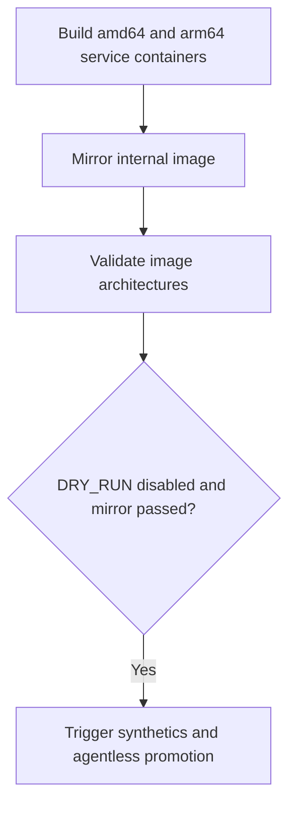

# `agentless-serverless-release`

This pipeline builds, mirrors, and validates the multi-architecture Agentless service image before optionally triggering serverless synthetics and promotion.

## At a glance

| | |
| --- | --- |
| Platform | Buildkite |
| Source | [`pipeline.agentless-app-release.yaml`](../pipeline.agentless-app-release.yaml) |
| Trigger | The primary `elastic-agent` pipeline triggers this pipeline on `main` and in dry-run mode for eligible PRs targeting `main`. |

## Purpose

The pipeline builds the `service` Docker variant for Linux amd64 and arm64, mirrors the resulting service image to the internal registry, validates that the image manifest contains both architectures, and conditionally triggers synthetics/promotion. The source history records that multi-architecture validation was added to ensure the internal service image was complete before subsequent steps.

## When it runs

The YAML does not define a branch filter. The checked-in caller config triggers it on `main`; for PRs targeting `main`, the caller sets `DRY_RUN=true`. The final promotion step is skipped when `DRY_RUN=true` and runs only if the mirror step passed. The downstream trigger also specifies `branches: main`.

## Execution flow

| Job or step | Runs when | Depends on | What it does |
| --- | --- | --- | --- |
| Package service containers | Every build | None declared | Builds service Docker packages on GCP amd64 and AWS arm64 agents. |
| Mirror image | After packaging wait | Both package steps complete | Runs [`ecp-internal-release.sh`](../scripts/steps/ecp-internal-release.sh) to load, tag, and push per-architecture images, then create a multi-architecture manifest and record commit metadata. |
| Validate image | After mirror wait | Prior pipeline steps complete via waits | Runs [`validate-agentless-docker-image.sh`](../scripts/steps/validate-agentless-docker-image.sh) and requires `amd64` and `arm64` in the internal image manifest. |
| Promote | Unless `DRY_RUN=true`, and only if mirroring passed | Mirror step | Dynamically triggers the serverless synthetics/GitOps pipeline with the short commit hash. |

## Inputs, outputs, and access

| Item | Details |
| --- | --- |
| Inputs | `VERSION` is the first 12 characters of `BUILDKITE_COMMIT`; `DRY_RUN` is supplied by the caller. |
| Outputs | Service container tar artifacts, internal per-architecture tags and multi-architecture manifest, Buildkite metadata, and optionally a downstream promotion build. |
| Permissions | Google OIDC and Vault-backed Docker registry login are used for publishing. |
| Secrets | The Docker login plugin references `elastic_docker_registry`; no credential values are in the source. |

## Operational notes

The pipeline waits between package, mirror, validation, and promotion stages. The promotion step's condition checks the mirror step outcome; it is not a general guarantee that the downstream synthetics pipeline succeeds. The downstream pipeline definition and GitOps repository are outside this repository.

## Sources and history

- Pipeline and caller: [`pipeline.agentless-app-release.yaml`](../pipeline.agentless-app-release.yaml), [`pipeline.yml`](../pipeline.yml)
- Scripts: [`integration-package.sh`](../scripts/steps/integration-package.sh), [`ecp-internal-release.sh`](../scripts/steps/ecp-internal-release.sh), [`validate-agentless-docker-image.sh`](../scripts/steps/validate-agentless-docker-image.sh)
- Relevant history: [`2812c6fb6c`](https://github.com/elastic/elastic-agent/commit/2812c6fb6c) adds the agentless release pipeline; [`a1f8d82a1a`](https://github.com/elastic/elastic-agent/commit/a1f8d82a1a) adds multi-architecture image validation.
