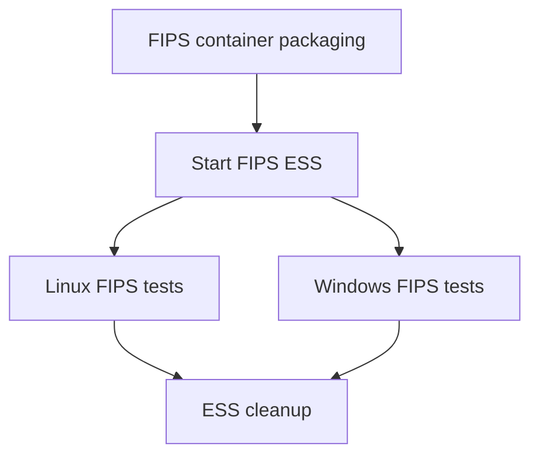

# FIPS extended integration steps

This dynamically uploaded Buildkite configuration provisions a FIPS ESS stack and runs FIPS integration tests on Linux and Windows.

## At a glance

| | |
| --- | --- |
| Platform | Buildkite |
| Source | [`bk.integration-fips.pipeline.yml`](../bk.integration-fips.pipeline.yml) |
| Trigger | Uploaded from [`integration.pipeline.yml`](../integration.pipeline.yml) for PRs with matching changes or for non-PR branch builds. |

## Purpose

The configuration adds a FIPS integration pass using FIPS container images and FIPS-enabled agent packages. Commit [`484f0e97d1`](https://github.com/elastic/elastic-agent/commit/484f0e97d1) records FIPS integration packaging coverage.

## When it runs

The PR upload is conditional on PR status and changes under `.buildkite/**`, `magefile.go`, `dev-tools/**`, or Go module files. A second upload step runs for non-PR builds. Jobs consume the FIPS package artifacts produced by the integration packaging configuration; an ECH upgrade step additionally has a PR-label condition.

## Execution flow

| Job or step | Runs when | Depends on | What it does |
| --- | --- | --- | --- |
| Start ESS | After both FIPS container package steps | amd64 and arm64 FIPS container packages | Provisions FIPS ESS using [`ess_start.sh`](../scripts/steps/ess_start.sh). |
| Linux tests | After ESS | FIPS amd64 or arm64 packages | Runs the `fleet` group with and without sudo on Ubuntu amd64/arm64; an ECH upgrade test is PR-label-gated. |
| Windows tests | After ESS | FIPS amd64 or arm64 packages | Runs `fleet` on Windows 2025 amd64 and Windows 11 ARM64 with the Windows FIPS policy enabled. |
| ESS cleanup | After both test groups, including failures | Linux and Windows groups | Downloads stack state and runs [`ess_down.sh`](../scripts/steps/ess_down.sh). |
| Aggregate reports | After test groups, including failures | Linux and Windows groups | Downloads JUnit XML and sends it to the test collector; it is soft-fail. |

## Inputs, outputs, and access

| Item | Details |
| --- | --- |
| Inputs | FIPS package artifacts; `FIPS=true`; test group/sudo matrix values; `GITHUB_PR_LABELS` for the optional ECH test. |
| Outputs | Integration artifacts, diagnostics under `build/**`, ESS state files, and JUnit annotations. |
| Permissions | Google OIDC and Vault-backed Elastic Cloud API-key access are configured. |
| Secrets | The source references a production Elastic Cloud API-key secret and Buildkite analytics token; values are not included. |

## Operational notes

Cleanup allows dependency failures so it can run after failed test groups. Linux and Windows jobs retry once. Commented staging-government settings are not active configuration.

## Sources and history

- Pipeline and uploader: [`bk.integration-fips.pipeline.yml`](../bk.integration-fips.pipeline.yml), [`integration.pipeline.yml`](../integration.pipeline.yml)
- Scripts: [`ess_start.sh`](../scripts/steps/ess_start.sh), [`integration_tests_tf.sh`](../scripts/steps/integration_tests_tf.sh), [`integration_tests_tf_fips.ps1`](../scripts/steps/integration_tests_tf_fips.ps1), [`ess_down.sh`](../scripts/steps/ess_down.sh)
- Relevant history: [`484f0e97d1`](https://github.com/elastic/elastic-agent/commit/484f0e97d1) adds FIPS integration packaging coverage.
