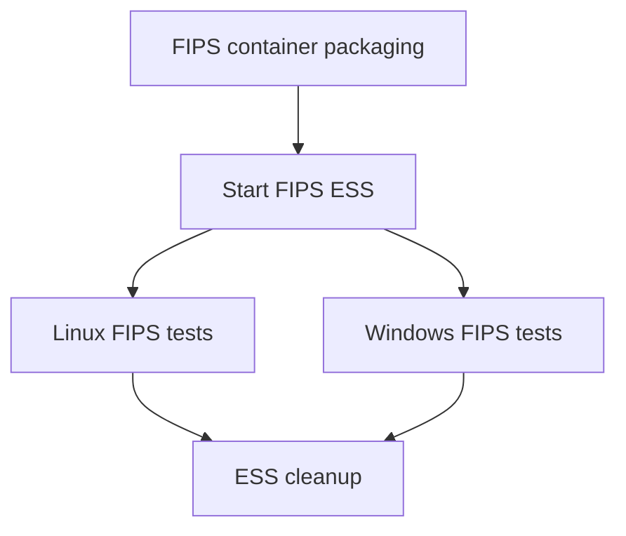

# FIPS extended integration steps

This dynamically uploaded Buildkite configuration provisions a FIPS ESS stack and runs FIPS integration tests on Linux and Windows.

## At a glance

| | |
| --- | --- |
| Platform | Buildkite |
| Source | [`bk.integration-fips.pipeline.yml`](../bk.integration-fips.pipeline.yml) |
| Trigger | Uploaded from [`integration.pipeline.yml`](../integration.pipeline.yml) for PRs with matching changes or for non-PR branch builds. |

## Purpose

The configuration adds a FIPS integration pass using FIPS container images and FIPS-enabled agent packages. Commit [`484f0e97d1`](https://github.com/elastic/elastic-agent/commit/484f0e97d1) records FIPS integration packaging coverage.

## When it runs

The PR upload is conditional on PR status and changes under `.buildkite/**`, `magefile.go`, `dev-tools/**`, or Go module files. A second upload step runs for non-PR builds. Jobs consume the FIPS package artifacts produced by the integration packaging configuration; an ECH upgrade step additionally has a PR-label condition.

## Execution flow

| Job or step | Runs when | Depends on | What it does |
| --- | --- | --- | --- |
| Start ESS | After both FIPS container package steps | amd64 and arm64 FIPS container packages | Provisions a shared FIPS ESS stack on FedRAMP Staging (`Target=frs`) with `oblt-cli`, using [`ess_start_oblt-cli.sh`](../scripts/steps/ess_start_oblt-cli.sh). |
| Linux tests | After ESS | FIPS amd64 or arm64 packages | Runs the `fleet` group with and without sudo on Ubuntu amd64/arm64; an ECH upgrade test is PR-label-gated. |
| Windows tests | After ESS | FIPS amd64 or arm64 packages | Runs `fleet` on Windows 2025 amd64 and Windows 11 ARM64 with the Windows FIPS policy enabled. |
| ESS cleanup | After both test groups, including failures | Linux and Windows groups | Destroys the shared and any orphaned retry clusters using [`ess_cleanup_all.sh`](../scripts/steps/ess_cleanup_all.sh). |
| Aggregate reports | After test groups, including failures | Linux and Windows groups | Downloads JUnit XML and sends it to the test collector; it is soft-fail. |

## Inputs, outputs, and access

| Item | Details |
| --- | --- |
| Inputs | FIPS package artifacts; `FIPS=true`; test group/sudo matrix values; `GITHUB_PR_LABELS` for the optional ECH test. |
| Outputs | Integration artifacts, diagnostics under `build/**`, and JUnit annotations. |
| Permissions | Google OIDC and a GitHub token (for `oblt-cli`, which opens the cluster configuration pull request) are configured. The `fips:upgrade-ech-deployment` step additionally uses a Vault-backed Elastic Cloud API key. |
| Secrets | The upgrade-ech step references a production Elastic Cloud API-key secret, and the aggregate step a Buildkite analytics token; values are not included. |

## Operational notes

Cleanup allows dependency failures so it can run after failed test groups. Linux and Windows jobs retry once. The stack is created with the generic `ess` template and `Target=frs`, as described in [Create an ECH cluster on FRS](https://github.com/elastic/observability-test-environments/blob/main/docs/kb/create-ech-cluster-on-frs.md). FRS has limited capacity, so the stack expires after 4 hours and is destroyed by the cleanup step. FRS only offers plain stack versions, so `StackBuildId` is not used.

The previous Terraform path pinned `-fips` Elasticsearch and Kibana images (`elasticsearch-cloud-ess-fips`, `kibana-cloud-fips`) as well as the `elastic-agent-cloud-fips` image. Now only the agent image is set; Elasticsearch and Kibana use what FRS provides. This assumes FRS stacks are FIPS compliant. If they aren't, the FIPS tests run against non-FIPS Elasticsearch and Kibana.

Every start attempt records its cluster under a `fips.retry-cluster-*` metadata key, so a start retry doesn't leave an untracked cluster behind. The cleanup step only tears down: it destroys the shared cluster and every recorded cluster, and it also runs when the start step fails.

## Sources and history

- Pipeline and uploader: [`bk.integration-fips.pipeline.yml`](../bk.integration-fips.pipeline.yml), [`integration.pipeline.yml`](../integration.pipeline.yml)
- Scripts: [`ess_start_oblt-cli.sh`](../scripts/steps/ess_start_oblt-cli.sh), [`ess_oblt-cli.sh`](../scripts/steps/ess_oblt-cli.sh), [`integration_tests_oblt-cli.sh`](../scripts/steps/integration_tests_oblt-cli.sh), [`integration_tests_tf_fips.ps1`](../scripts/steps/integration_tests_tf_fips.ps1), [`ess.ps1`](../scripts/steps/ess.ps1), [`ess_cleanup_all.sh`](../scripts/steps/ess_cleanup_all.sh)
- Relevant history: [`484f0e97d1`](https://github.com/elastic/elastic-agent/commit/484f0e97d1) adds FIPS integration packaging coverage.
