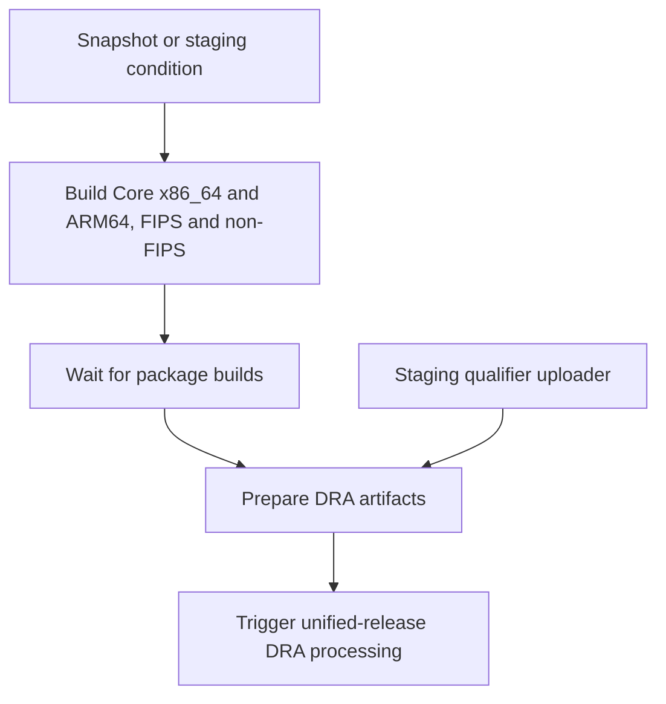

# `elastic-agent-binary-dra`

This pipeline builds Elastic Agent Core snapshots or staging packages and prepares them for the unified-release DRA processor.

## At a glance

| | |
| --- | --- |
| Platform | Buildkite |
| Source | [`pipeline.elastic-agent-binary-dra.yml`](../pipeline.elastic-agent-binary-dra.yml), registered in [`catalog-info.yaml`](../../catalog-info.yaml) |
| Trigger | Branch configuration `main`, `7.*`, `8.*`, `9.*`; daily schedule on `main`; PR builds are enabled for allowed non-fork sources in the repository resource. |

## Purpose

The pipeline produces the Elastic Agent Core artifacts separately from full package publishing and stages them for DRA. The October 2026 migration replaces legacy Release Manager collection with the `elastic/dra-prep` plugin. The migration history explains that staging uses a dynamic uploader so the runtime `VERSION_QUALIFIER` is included in the DRA version.

## When it runs

Snapshot builds run when `RUN_SNAPSHOT=true` or for unqualified `main`/release-branch builds. Staging builds run on release branches, when `RUN_STAGING=true`, or when a version qualifier is present. DRA preparation and downstream processing are limited to non-PR `main` or release-branch builds; the configured schedule runs daily on `main`.

## Execution flow

| Job or step | Runs when | Depends on | What it does |
| --- | --- | --- | --- |
| Snapshot group | Snapshot condition matches | None declared | Builds Linux, Windows, and macOS Core archives for x86_64/ARM64, with FIPS variants, using [`build-agent-core.sh`](../scripts/steps/build-agent-core.sh). |
| Snapshot DRA prep and trigger | Non-PR `main` or release branch | Snapshot build group | [`stage_artifacts.sh`](../scripts/stage_artifacts.sh) downloads and filters artifacts, then `elastic/dra-prep` stages them and triggers `unified-release-dra-processing`. |
| Staging group | Staging condition matches | None declared | Loads the branch qualifier via [`version_qualifier.sh`](../scripts/version_qualifier.sh), then builds the same architecture/FIPS variants. |
| Dynamic staging DRA upload | Non-PR `main` or release branch | Staging build group | [`upload_dra_staging.sh`](../scripts/upload_dra_staging.sh) resolves the full version and uploads DRA prep and processing steps. |
| Helm snapshot trigger | Non-main branch within snapshot group | None declared | Triggers the helm-chart pipeline with snapshot/dev parameters. |

## Inputs, outputs, and access

| Item | Details |
| --- | --- |
| Inputs | `RUN_SNAPSHOT`, `RUN_STAGING`, `VERSION_QUALIFIER`, `DRA_WORKFLOW`, `PLATFORMS`, and `FIPS`; branch, commit, and `.package-version` supply version metadata. |
| Outputs | Core packages and dependency reports under `build/distributions/**`; DRA-prep consumes filtered packages and checksums. |
| Permissions | Google OIDC and the `elastic/dra-prep` plugin are configured. |
| Secrets | No secret values are embedded in the checked-in pipeline; DRA access is managed by configured Buildkite plugins. |

## Operational notes

The DRA prep script expects at least one matching binary and exactly one dependency-report CSV. Snapshot artifact selection includes `-SNAPSHOT`; staging excludes it. Snapshot and staging DRA steps do not publish from PRs or feature branches unless the source's branch conditions match.

## Sources and history

- Pipeline and registration: [`pipeline.elastic-agent-binary-dra.yml`](../pipeline.elastic-agent-binary-dra.yml), [`catalog-info.yaml`](../../catalog-info.yaml)
- Build and staging scripts: [`build-agent-core.sh`](../scripts/steps/build-agent-core.sh), [`stage_artifacts.sh`](../scripts/stage_artifacts.sh), [`upload_dra_staging.sh`](../scripts/upload_dra_staging.sh), [`version_qualifier.sh`](../scripts/version_qualifier.sh)
- Relevant history: [`0058b5b18e`](https://github.com/elastic/elastic-agent/commit/0058b5b18e) migrates Core DRA handling to `dra-prep` and records the dynamic staging-version rationale.
