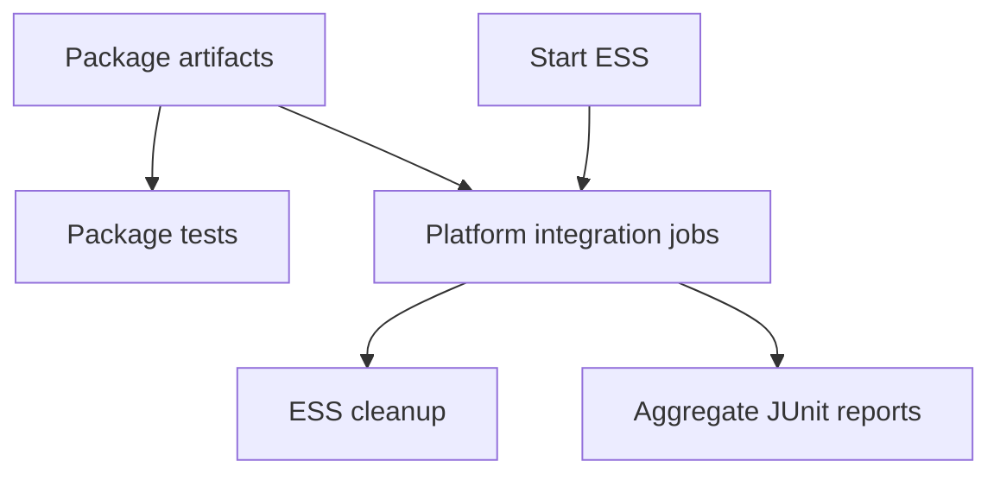

# `elastic-agent-extended-testing`

The extended-testing pipeline packages platform artifacts and runs tiered integration coverage for Elastic Agent.

## At a glance

| | |
| --- | --- |
| Platform | Buildkite |
| Source | [`integration.pipeline.yml`](../integration.pipeline.yml) and [`bk.integration.pipeline.yml`](../bk.integration.pipeline.yml), registered together in [`catalog-info.yaml`](../../catalog-info.yaml) |
| Trigger | Uploaded by the primary pipeline for eligible changes; its catalog resource sets `trigger_mode: none`. Tier 3 also accepts scheduled builds. |

## Purpose

The pipeline separates platform package builds from broad integration tests so test jobs can consume artifacts as soon as the relevant package is ready. The matrix groups tests into PR tier 1, source-filtered tier 2, and scheduled tier 3. Commit [`6055fc33f8`](https://github.com/elastic/elastic-agent/commit/6055fc33f8) explains the package split and the removal of an intermediate upload hop.

## When it runs

The main `elastic-agent` pipeline uploads both files for eligible PRs (unless `skip-it` is labeled, unless extended tests were explicitly requested) and for non-PR, non-scheduled branch builds. PR uploads have `if_changed` filters over code, tests, specs, packaging, and CI files; branch uploads do not. Tier 1 is PR-only, tier 2 is selected by build/test/deployment source changes, and tier 3 runs for schedules or builds triggered by `elastic-agent-pipeline-scheduler`.

## Execution flow

| Job or step | Runs when | Depends on | What it does |
| --- | --- | --- | --- |
| Platform packaging | Uploaded integration configuration | None declared | Builds Linux, Windows, ARM64, FIPS, and container packages. Container amd64 steps also push CI cloud images. |
| FIPS configuration upload | PR or branch | PR upload is file-filtered; branch upload is unconditional | Uploads [`bk.integration-fips.pipeline.yml`](../bk.integration-fips.pipeline.yml). |
| Package tests | After packaging group | `int-packaging` | Downloads package artifacts and runs [`package-tests.sh`](../scripts/steps/package-tests.sh). |
| ESS provisioning | Extended-test flow | None declared | Starts a shared ESS stack and pre-installs Fleet packages via [`ess_start_oblt-cli.sh`](../scripts/steps/ess_start_oblt-cli.sh). |
| Test tiers | Tier-dependent | ESS and required platform artifacts | Runs ECH, Windows/Linux, Kubernetes/OpenShift, and serverless tests through the configured scripts and matrices. |
| Cleanup and report aggregation | At the end of test flow | Integration groups; dependency failures allowed | Removes shared/retry ESS clusters and collects JUnit XML. Report aggregation is soft-fail. |

## Inputs, outputs, and access

| Item | Details |
| --- | --- |
| Inputs | Buildkite PR/schedule metadata, `.package-version`, and matrix-selected OS, architecture, group/variant, and sudo values. |
| Outputs | `build/distributions/**`, test XML/JSON/HTML, diagnostics, Kubernetes logs, and container images. |
| Permissions | Google OIDC, `oblt-cli`, Vault-backed GitHub access, and Docker registry login are used by configured jobs. |
| Secrets | The source names `elastic_docker_registry`, `buildkite_analytics_token`, and serverless integration secret references; values are external. |

## Operational notes

Test steps have automatic retries and upload diagnostics. OpenShift steps are soft-fail in the checked-in configuration. Tier 3 uses schedule metadata to select broader coverage. Runtime-generated steps can exceed the static YAML; this page describes only the checked-in definitions and upload logic.

## Sources and history

- Pipeline definitions and registration: [`integration.pipeline.yml`](../integration.pipeline.yml), [`bk.integration.pipeline.yml`](../bk.integration.pipeline.yml), [`catalog-info.yaml`](../../catalog-info.yaml)
- Test runners: [`integration_tests_oblt-cli.sh`](../scripts/steps/integration_tests_oblt-cli.sh), [`integration_tests_tf.ps1`](../scripts/steps/integration_tests_tf.ps1), [`buildkite-integration-tests.sh`](../scripts/buildkite-integration-tests.sh), [`buildkite-integration-tests.ps1`](../scripts/buildkite-integration-tests.ps1)
- Relevant history: [`6055fc33f8`](https://github.com/elastic/elastic-agent/commit/6055fc33f8) records the platform-specific packaging and trigger-flow rationale; [`c49b8c6996`](https://github.com/elastic/elastic-agent/commit/c49b8c6996) adds MicroShift coverage.
