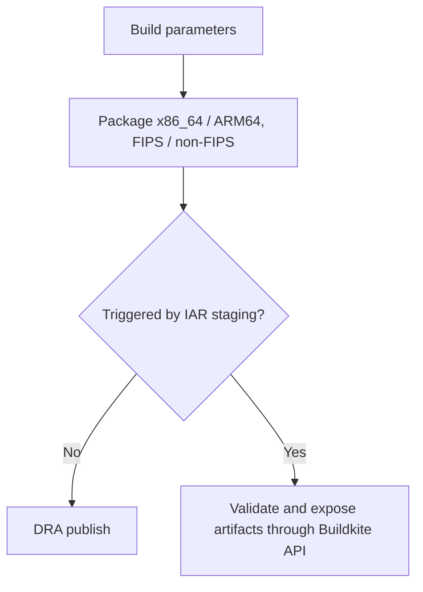

# `elastic-agent-package`

This pipeline builds full Elastic Agent packages for DRA workflows and publishes or returns the artifacts to the triggering release pipeline.

## At a glance

| | |
| --- | --- |
| Platform | Buildkite |
| Source | [`pipeline.elastic-agent-package.yml`](../pipeline.elastic-agent-package.yml), registered as `elastic-agent-package` in [`catalog-info.yaml`](../../catalog-info.yaml) |
| Trigger | `catalog-info.yaml` disables branch builds and configures PR builds; the primary pipeline also triggers generated PR checks. |

## Purpose

The pipeline packages agent binaries for x86_64 and ARM64, with separate FIPS and non-FIPS steps, then publishes them using the selected DRA workflow. A special path supports the independent-agent-release staging pipeline by returning artifacts and recording metadata for the upstream job. PR checks trigger both locally built-core and manifest-sourced package variants.

## When it runs

The registered pipeline is configured for PR builds (excluding forks and gated by the Buildkite PR filter), but not branch builds. The primary pipeline's PR trigger scripts provide `snapshot` or `staging` DRA parameters and set dry-run mode. The publish step chooses its route based on `BUILDKITE_TRIGGERED_FROM_BUILD_PIPELINE_SLUG`.

## Execution flow

| Job or step | Runs when | Depends on | What it does |
| --- | --- | --- | --- |
| Build parameters | Manual or triggered pipeline build | None declared | Collects manifest URL, verbosity, DRA workflow/version, and dry-run choice. |
| Package group | Every pipeline build | Build parameters | Runs [`package.sh`](../scripts/steps/package.sh) for x86_64/ARM64 with FIPS enabled/disabled and uploads `build/distributions/**/*`. |
| Publishing to DRA | Not triggered by `independent-agent-release-staging` | Package group | Downloads artifacts, adjusts permissions, restores DRA inputs, and invokes [`dra-publish.sh`](../scripts/steps/dra-publish.sh). |
| Independent-agent release publish | Triggered by `independent-agent-release-staging` | Package group | Validates DRA collection in dry-run mode, uploads artifact paths, and sets upstream job metadata when `TRIGGER_JOB_ID` is present. |

## Inputs, outputs, and access

| Item | Details |
| --- | --- |
| Inputs | `MANIFEST_URL`, `MAGEFILE_VERBOSE`, `DRA_WORKFLOW`, `DRA_VERSION`, `DRA_DRY_RUN`, `DRA_BRANCH`, and Buildkite trigger metadata. |
| Outputs | Cross-platform packages and dependency report CSV under `build/distributions/**`; artifacts are either collected by DRA or returned through Buildkite artifacts. |
| Permissions | Google OIDC and Docker registry login are configured. The Release Manager container reads Vault credential environment variables supplied at runtime; their injection is not defined in this repository. |
| Secrets | The Docker plugin references `elastic_docker_registry`; the script expects `VAULT_ADDR_SECRET`, `VAULT_ROLE_ID_SECRET`, and `VAULT_SECRET`. Values are external. |

## Operational notes

If a manifest URL is supplied, `package.sh` treats it as the agent-core source of truth; otherwise it reads the package version from `.package-version`. FIPS packaging omits the helm and Iron Bank Mage targets. Slack notifications are configured in `catalog-info.yaml`, not in the pipeline YAML itself.

## Sources and history

- Pipeline and registration: [`pipeline.elastic-agent-package.yml`](../pipeline.elastic-agent-package.yml), [`catalog-info.yaml`](../../catalog-info.yaml)
- Package triggers: [`trigger-elastic-agent-package.sh`](../scripts/steps/trigger-elastic-agent-package.sh), [`trigger-elastic-agent-package-iar.sh`](../scripts/steps/trigger-elastic-agent-package-iar.sh), [`trigger-elastic-agent-package-staging.sh`](../scripts/steps/trigger-elastic-agent-package-staging.sh)
