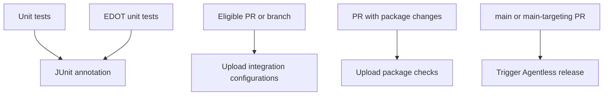

# `elastic-agent`

The primary Buildkite pipeline runs repository checks and unit tests, then conditionally uploads extended tests, package checks, Kubernetes sync, and serverless release work.

## At a glance

| | |
| --- | --- |
| Platform | Buildkite |
| Source | [`pipeline.yml`](../pipeline.yml), registered as `elastic-agent` in [`catalog-info.yaml`](../../catalog-info.yaml) |
| Trigger | `main`, `7.*`, `8.*`, and `9.*`; PR integration settings are in [`pull-requests.json`](../pull-requests.json). |

## Purpose

This is the main CI entry point. It runs repository checks, root-module and EDOT unit tests on configured platforms, and Kubernetes tests. Conditional trigger steps upload additional test and release pipeline definitions. The EDOT module is tested separately because it is a distinct Go module and colocating its tests starves root-module tests of CPU.

## When it runs

The catalog resource configures `main`, `7.*`, `8.*`, and `9.*` branches and enables PR builds subject to its provider filter. The PR integration file defines comment-trigger patterns. Extended tests upload for eligible PRs unless labeled `skip-it` (or when a comment requests extended tests), and for non-PR, non-scheduled branch builds. Package test triggers are PR-only and filtered by relevant package sources. Serverless dry-run runs for eligible PRs to `main`; serverless publishing is triggered on `main`.

## Execution flow

| Job or step | Runs when | Depends on | What it does |
| --- | --- | --- | --- |
| `check-ci` | Main pipeline build | None declared | Runs `make check-ci` via [`check-ci.sh`](../scripts/steps/check-ci.sh). |
| Unit tests | Main pipeline build | None declared | Runs root-module Mage unit tests on Linux, Windows, and Windows ARM64 using [`unit-tests.sh`](../scripts/steps/unit-tests.sh) and [`unit-tests.ps1`](../scripts/steps/unit-tests.ps1); FIPS-tag variants are configured. |
| EDOT unit tests | Main pipeline build | None declared | Tests `internal/edot` separately with the same scripts. Some platforms are explicitly skipped. |
| JUnit annotation | Main pipeline build | Test jobs; failures allowed | Annotates available XML reports. |
| Kubernetes tests | Main pipeline build | None declared | Runs a version matrix through [`k8s-tests.sh`](../scripts/steps/k8s-tests.sh). |
| K8s sync | `main` with matching Kubernetes/version-doc changes | None declared | Generates manifests and opens the Kibana templates PR via [`sync-k8s.sh`](../scripts/steps/sync-k8s.sh). |
| Extended tests | Eligible PR or branch | None declared | Uploads [`integration.pipeline.yml`](../integration.pipeline.yml) and [`bk.integration.pipeline.yml`](../bk.integration.pipeline.yml). |
| Package checks | PR with matching package changes | None declared | Generates checks using [`trigger-elastic-agent-package.sh`](../scripts/steps/trigger-elastic-agent-package.sh), [`trigger-elastic-agent-package-iar.sh`](../scripts/steps/trigger-elastic-agent-package-iar.sh), and [`trigger-elastic-agent-package-staging.sh`](../scripts/steps/trigger-elastic-agent-package-staging.sh). |
| Agentless release | Main; dry-run for eligible PRs to `main` | Root pipeline `wait` before the main publish step | Triggers `agentless-serverless-release` with the current commit; the PR path passes `DRY_RUN=true`. |

## Inputs, outputs, and access

| Item | Details |
| --- | --- |
| Inputs | Buildkite branch/PR metadata, `GITHUB_PR_LABELS`, `GITHUB_PR_TRIGGER_COMMENT`, and step `if_changed` filters. |
| Outputs | Test XML/HTML, diagnostics, coverage, and package artifacts; additional pipeline steps are uploaded or triggered. |
| Permissions | Google OIDC is used where configured. Some jobs use Vault-backed Docker, GitHub, and Buildkite analytics credentials. |
| Secrets | References include `elastic_docker_registry` and `buildkite_analytics_token`; secret values are external. |

## Operational notes

macOS unit tests for both the root module and EDOT run in the [`macos-unit-tests`](../../.github/workflows/macos-unit-tests.yml) GitHub Actions workflow instead of Buildkite, because of Orka slowness. Windows 11 disables the race detector because the source records a platform-specific Go runtime crash. Each `if_changed` list is part of the condition and should be read with the step condition.

## Sources and history

- Pipeline and registrations: [`pipeline.yml`](../pipeline.yml), [`catalog-info.yaml`](../../catalog-info.yaml), [`pull-requests.json`](../pull-requests.json)
- Scripts: [`steps/`](../scripts/steps/)
- Relevant history: [`410bb189a9`](https://github.com/elastic/elastic-agent/commit/410bb189a9) separates EDOT tests to reduce CPU contention; [`8b1ea4c903`](https://github.com/elastic/elastic-agent/commit/8b1ea4c903) skips the slow macOS test step.
