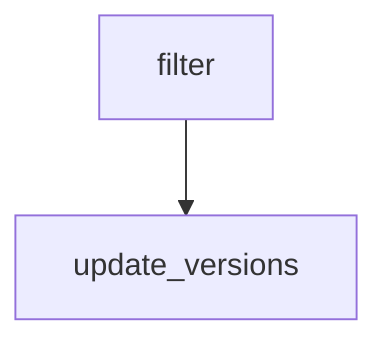

# update-agent-versions

This GitHub Actions workflow coordinates **update-agent-versions** from the checked-in definition.

## At a glance

| | |
| --- | --- |
| Platform | GitHub Actions |
| Source | [`.github/workflows/bump-agent-versions.yml`](../bump-agent-versions.yml) |
| Trigger | workflow_dispatch; schedule |

## Purpose

The workflow is named **update-agent-versions** and is configured to run the declared jobs: `filter`, `update_versions`. Its operational purpose is defined by those jobs and their source steps; the checked-in file does not state additional rationale.

## When it runs

Runs on a schedule; consult the workflow source for the current scheduler configuration.
The configured trigger events and filters are:

- `workflow_dispatch`
- `schedule`

## Execution flow

| Job | Runs when | Depends on | Runner or reusable workflow |
| --- | --- | --- | --- |
| `filter` | Always when triggered | None declared | ubuntu-slim |
| `update_versions` | Always when triggered | `[filter]` | ubuntu-latest |

### Steps

#### `filter`

| Step | Action or command | Condition |
| --- | --- | --- |
| step-1 | elastic/oblt-actions/elastic/active-branches@v1 | Always when job runs |
|  | Inputs: `filter-branches` |  |
#### `update_versions`

| Step | Action or command | Condition |
| --- | --- | --- |
| Create ephemeral GitHub token | elastic/oblt-actions/github/create-token@v1 | Always when job runs |
|  | Inputs: `token-policy` |  |
| Checkout | actions/checkout@v7 | Always when job runs |
|  | Inputs: `submodules, ref, token, fetch-depth` |  |
| Set up Go | actions/setup-go@v7 | Always when job runs |
|  | Inputs: `go-version-file` |  |
| Set git config | `git config --global user.email "41898282+github-actions[bot]@users.noreply.github.com"` | Always when job runs |
| Install mage | magefile/mage-action@a662bd8c29d8106879588cfff83b2faf6e6f59db | Always when job runs |
|  | Inputs: `version, install-only` |  |
| Update versions | `./.github/workflows/bump-agent-versions.sh` | Always when job runs |
| step-7 | slackapi/slack-github-action@dcb1066f776dd043e64d0e8ba94ca15cc7e1875d | ${{ failure()  }} |
|  | Inputs: `method, token, payload` |  |
| step-8 | slackapi/slack-github-action@dcb1066f776dd043e64d0e8ba94ca15cc7e1875d | ${{ startsWith(steps.update.outputs.pr, 'https') }} |
|  | Inputs: `method, token, payload` |  |

The tables above summarize the complete job and step structure; action implementations referenced outside this repository are not expanded.

## Inputs, outputs, and access

| Item | Details |
| --- | --- |
| Inputs | No workflow inputs are declared. |
| Environment | No workflow-level environment variables are declared. |
| Outputs | Job outputs: `filter`: matrix |
| Permissions | `{contents: read}` |
| Deployment environments | No job deployment environment is declared. |

## Operational notes

This page documents checked-in configuration only. It does not prove successful runs or that remote action and reusable-workflow implementations match their referenced revisions.

Referenced local sources:

- [`.github/workflows/bump-agent-versions.sh`](../../../.github/workflows/bump-agent-versions.sh)

## Sources
- External action or reusable workflow: `elastic/oblt-actions/elastic/active-branches@v1` (implementation not checked in this repository).
- External action or reusable workflow: `elastic/oblt-actions/github/create-token@v1` (implementation not checked in this repository).

- Workflow: [`.github/workflows/bump-agent-versions.yml`](../bump-agent-versions.yml)
- Referenced local file: [`.github/workflows/bump-agent-versions.sh`](../../../.github/workflows/bump-agent-versions.sh)
- External action or reusable workflow: `actions/checkout@v7` (implementation not checked in this repository).
- External action or reusable workflow: `actions/setup-go@v7` (implementation not checked in this repository).
- External action or reusable workflow: `magefile/mage-action@a662bd8c29d8106879588cfff83b2faf6e6f59db` (implementation not checked in this repository).
- External action or reusable workflow: `slackapi/slack-github-action@dcb1066f776dd043e64d0e8ba94ca15cc7e1875d` (implementation not checked in this repository).
