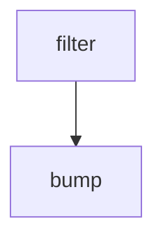

# bump-vm-images

This GitHub Actions workflow coordinates **bump-vm-images** from the checked-in definition.

## At a glance

| | |
| --- | --- |
| Platform | GitHub Actions |
| Source | [`.github/workflows/bump-vm-images.yml`](../bump-vm-images.yml) |
| Trigger | workflow_dispatch; schedule |

## Purpose

The workflow is named **bump-vm-images** and is configured to run the declared jobs: `filter`, `bump`. Its operational purpose is defined by those jobs and their source steps; the checked-in file does not state additional rationale.

## When it runs

Runs on a schedule; consult the workflow source for the current scheduler configuration.
The configured trigger events and filters are:

- `workflow_dispatch`
- `schedule`

## Execution flow

| Job | Runs when | Depends on | Runner or reusable workflow |
| --- | --- | --- | --- |
| `filter` | Always when triggered | None declared | ubuntu-slim |
| `bump` | Always when triggered | `[filter]` | ubuntu-latest |

### Steps

#### `filter`

| Step | Action or command | Condition |
| --- | --- | --- |
| step-1 | elastic/oblt-actions/elastic/active-branches@v1 | Always when job runs |
|  | Inputs: `filter-branches` |  |
#### `bump`

| Step | Action or command | Condition |
| --- | --- | --- |
| step-1 | actions/checkout@v7 | Always when job runs |
|  | Inputs: `ref` |  |
| step-2 | elastic/oblt-actions/updatecli/run@v1 | Always when job runs |
|  | Inputs: `command, version-file` |  |
| step-3 | elastic/oblt-actions/slack/send@v1 | ${{ failure()  }} |
|  | Inputs: `bot-token, channel-id, message` |  |

The tables above summarize the complete job and step structure; action implementations referenced outside this repository are not expanded.

## Inputs, outputs, and access

| Item | Details |
| --- | --- |
| Inputs | No workflow inputs are declared. |
| Environment | Workflow variables: JOB_URL |
| Outputs | Job outputs: `filter`: matrix |
| Permissions | `{contents: read}` |
| Deployment environments | No job deployment environment is declared. |

## Operational notes

This page documents checked-in configuration only. It does not prove successful runs or that remote action and reusable-workflow implementations match their referenced revisions.

## Sources
- External action or reusable workflow: `elastic/oblt-actions/elastic/active-branches@v1` (implementation not checked in this repository).
- External action or reusable workflow: `elastic/oblt-actions/slack/send@v1` (implementation not checked in this repository).
- External action or reusable workflow: `elastic/oblt-actions/updatecli/run@v1` (implementation not checked in this repository).

- Workflow: [`.github/workflows/bump-vm-images.yml`](../bump-vm-images.yml)
- External action or reusable workflow: `actions/checkout@v7` (implementation not checked in this repository).
