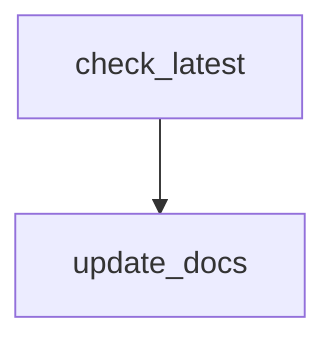

# Update documentation

This GitHub Actions workflow coordinates **Update documentation** from the checked-in definition.

## At a glance

| | |
| --- | --- |
| Platform | GitHub Actions |
| Source | [`.github/workflows/update-docs.yml`](../update-docs.yml) |
| Trigger | release: types: published; schedule; workflow_dispatch |

## Purpose

The workflow is named **Update documentation** and is configured to run the declared jobs: `check-latest`, `update-docs`. Its operational purpose is defined by those jobs and their source steps; the checked-in file does not state additional rationale.

## When it runs

Runs on a schedule; consult the workflow source for the current scheduler configuration.
The configured trigger events and filters are:

- `release: types: published`
- `schedule`
- `workflow_dispatch`

## Execution flow

| Job | Runs when | Depends on | Runner or reusable workflow |
| --- | --- | --- | --- |
| `check-latest` | Always when triggered | None declared | ubuntu-latest |
| `update-docs` | needs.check-latest.outputs.is_latest == 'true' | check-latest | ubuntu-latest |

### Steps

#### `check-latest`

| Step | Action or command | Condition |
| --- | --- | --- |
| Checkout repository | actions/checkout@v7 | Always when job runs |
|  | Inputs: `fetch-depth` |  |
| Add upstream remote and fetch tags | `git remote add upstream https://github.com/elastic/elastic-agent.git \|\| true` | Always when job runs |
| Find latest semantic version | `if [[ "${{ github.event_name }}" == "release" ]]; then` | Always when job runs |
| Check if this is the latest release | `LATEST=$(git tag --list \| grep -E "^v[0-9]+\.[0-9]+\.[0-9]+$" \| sort -V \| tail -1)` | Always when job runs |
#### `update-docs`

| Step | Action or command | Condition |
| --- | --- | --- |
| Checkout repository | actions/checkout@v7 | Always when job runs |
|  | Inputs: `ref, submodules, fetch-depth, persist-credentials` |  |
| Add upstream remote and fetch tags | `git remote add upstream https://github.com/elastic/elastic-agent.git \|\| true` | Always when job runs |
| Pass version to script | `echo "LATEST_VERSION=${{ needs.check-latest.outputs.version }}" >> $GITHUB_ENV` | Always when job runs |
| Set up Python | actions/setup-python@v7 | Always when job runs |
|  | Inputs: `python-version, cache` |  |
| Install dependencies | `python -m pip install --upgrade pip` | Always when job runs |
| Run documentation generator | `cd docs/scripts/update-docs` | Always when job runs |
| Check if branch already exists | `BRANCH_NAME="update-docs-${{ needs.check-latest.outputs.version }}"` | Always when job runs |
| Create Pull Request | peter-evans/create-pull-request@5f6978faf089d4d20b00c7766989d076bb2fc7f1 | steps.check_branch.outputs.branch_exists == 'false' |
|  | Inputs: `token, commit-message, title, body, branch, base, delete-branch, labels` |  |
| Skip PR creation (branch exists) | `echo "✅ Documentation for version ${{ needs.check-latest.outputs.version }} has already been updated."` | steps.check_branch.outputs.branch_exists == 'true' |

The tables above summarize the complete job and step structure; action implementations referenced outside this repository are not expanded.

## Inputs, outputs, and access

| Item | Details |
| --- | --- |
| Inputs | No workflow inputs are declared. |
| Environment | No workflow-level environment variables are declared. |
| Outputs | Job outputs: `check-latest`: is_latest, version |
| Permissions | `{contents: read}` |
| Deployment environments | No job deployment environment is declared. |

## Operational notes

This page documents checked-in configuration only. It does not prove successful runs or that remote action and reusable-workflow implementations match their referenced revisions.

Referenced local sources:

- [`docs/scripts/update-docs`](../../../docs/scripts/update-docs)
- [`docs/scripts/update-docs/requirements.txt`](../../../docs/scripts/update-docs/requirements.txt)

## Sources

- Workflow: [`.github/workflows/update-docs.yml`](../update-docs.yml)
- External action or reusable workflow: `actions/checkout@v7` (implementation not checked in this repository).
- External action or reusable workflow: `actions/setup-python@v7` (implementation not checked in this repository).
- External action or reusable workflow: `peter-evans/create-pull-request@5f6978faf089d4d20b00c7766989d076bb2fc7f1` (implementation not checked in this repository).
